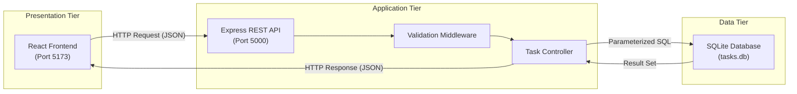

# OpenTask — Open-Source Task Management System

[](https://github.com/saheena-si/opentask-oss-lab/actions/workflows/ci.yml)
[](LICENSE)
[](https://nodejs.org/)
[](https://react.dev/)
[](https://sqlite.org/)

An open-source full-stack task management web application built for an Open Source Software (OSS) Lab mini project using React, Express, and SQLite.

---

## 1. Project Overview

**OpenTask** is a lightweight, responsive task management tool that enables individuals and teams to organize daily priorities, monitor task progression, and maintain deadlines. Built with modern web technologies, it features an interactive dashboard, parameterized relational data persistence, automated test suites, and GitHub Actions CI automation.

---

## 2. Problem Statement

Students, developers, and knowledge workers frequently struggle with managing scattered assignments, prioritizing urgent tasks, and keeping track of task lifecycle states. Existing enterprise task managers often impose complex workflows, paid subscription paywalls, or privacy-invasive third-party trackers.

**OpenTask** provides a straightforward, transparent, self-hosted open-source solution that stores tasks in a local SQLite database with zero external cloud dependencies.

---

## 3. Project Objectives

1. Develop a responsive, accessible React Single Page Application (SPA).
2. Build a modular RESTful API utilizing Node.js and Express.
3. Implement persistent data storage using a local SQLite relational database.
4. Provide complete Create, Read, Update, and Delete (CRUD) operations.
5. Practice real-world Git version control, branching, and open-source contribution practices.
6. Configure automated unit/integration testing and Continuous Integration (CI) with GitHub Actions.
7. Maintain clean documentation suitable for academic evaluation and OSS portfolio demonstration.

---

## 4. Key Features

- **📊 Interactive Dashboard**: Displays real-time counts for Total, Pending, In Progress, and Completed tasks with a dynamic completion percentage progress bar.
- **⚡ Full CRUD Operations**: Create tasks, view full details in a modal, edit attributes, and delete with an explicit confirmation dialog.
- **🔍 Search & Multi-Criteria Filtering**: Instant case-insensitive title search combined with status and priority dropdowns, plus a one-click filter reset.
- **🏷️ Badges & Overdue Tracking**: Visual priority indicators (*High*, *Medium*, *Low*), status badges (*Pending*, *In Progress*, *Completed*), and automatic overdue highlights for past deadlines.
- **🔄 Quick Status Cycling**: Advance workflow status directly from task cards with a single click.
- **🛡️ Data Integrity & Safety**: Server-side validation, parameterized SQL statements, and safe initial demo seeding with duplicate protection.
- **📱 Fully Responsive**: Fluid CSS layout optimized for both desktop monitors and mobile devices.

---

## 5. Technology Stack

### Frontend
- **React 18**: Component-based UI rendering and state management.
- **Vite 6**: Fast development server and optimized production bundler.
- **JavaScript (ES6+)**: Modern asynchronous programming.
- **HTML5 & CSS3**: Semantic structure, CSS custom properties, and responsive grid/flexbox layouts.
- **React Hooks**: `useState`, `useEffect`, `useCallback`, `useRef`.

### Backend
- **Node.js 24**: High-performance JavaScript runtime.
- **Express.js 4**: Web application framework and REST routing.
- **CORS**: Cross-Origin Resource Sharing configuration for local development.
- **dotenv**: Environment variable management.

### Database
- **SQLite**: Self-contained, zero-configuration relational database engine accessed natively via Node.js standard library `node:sqlite` (`DatabaseSync`).

### Testing & DevOps
- **Node.js Test Runner (`node:test`)**: Built-in test execution runner.
- **Node.js Assertions (`node:assert/strict`)**: Native strict assertion library.
- **GitHub Actions**: Continuous Integration pipeline checking frontend builds and backend test suites on push and pull requests.

---

## 6. Architecture & Request Flow

OpenTask implements a classic 3-tier architecture:



### Request Lifecycle Example (Creating a Task)
1. The user inputs task data into `TaskForm.jsx` and clicks **Create Task**.
2. Frontend validation verifies the title is non-empty.
3. `frontend/src/services/api.js` dispatches `POST /api/tasks` with JSON payload.
4. Backend `validateTask` middleware validates attributes and sanitizes inputs.
5. `taskController.js` executes parameterized `INSERT INTO tasks (...) VALUES (?, ?, ...)` via `node:sqlite`.
6. SQLite returns the generated `lastInsertRowid`.
7. Express responds with HTTP `201 Created` and the new task object.
8. React updates application state and renders a success toast notification.

---

## 7. Repository Structure

```
opentask-oss-lab/
├── .github/
│   ├── ISSUE_TEMPLATE/
│   │   ├── bug_report.md          # Bug report template
│   │   ├── feature_request.md     # Feature suggestion template
│   │   └── config.yml             # Issue configuration
│   ├── workflows/
│   │   └── ci.yml                 # GitHub Actions CI workflow
│   └── PULL_REQUEST_TEMPLATE.md   # Pull request checklist template
├── backend/
│   ├── data/                      # Local SQLite database (git-ignored)
│   ├── src/
│   │   ├── controllers/           # REST API controllers
│   │   │   └── taskController.js
│   │   ├── database/              # SQLite connection and demo seed
│   │   │   ├── db.js
│   │   │   └── seed.js
│   │   ├── middleware/            # Validation and error handling
│   │   │   ├── errorHandler.js
│   │   │   └── validateTask.js
│   │   ├── routes/                # Express API route declarations
│   │   │   └── taskRoutes.js
│   │   └── app.js                 # Express application configuration
│   ├── tests/                     # Automated test suites
│   │   ├── db.test.js             # Database schema and constraints
│   │   └── task.test.js           # API CRUD and integration tests
│   ├── .env.example               # Backend environment variables template
│   ├── package.json               # Backend dependencies and scripts
│   └── server.js                  # Backend HTTP listener entry point
├── docs/
│   ├── API_DOCUMENTATION.md       # Comprehensive REST API reference
│   ├── ARCHITECTURE.md            # In-depth architectural design
│   ├── INSTALLATION.md            # Detailed setup & troubleshooting guide
│   ├── ISSUES_TO_CREATE.md        # Prepared GitHub Issues backlog
│   ├── REQUIREMENTS.md            # System requirements specification
│   ├── TESTING.md                 # Testing strategy & test execution report
│   └── USER_GUIDE.md              # Feature-by-feature interactive user guide
├── frontend/
│   ├── public/
│   │   └── favicon.svg            # OpenTask favicon
│   ├── src/
│   │   ├── components/            # Modular React components
│   │   │   ├── ConfirmDialog.jsx
│   │   │   ├── Dashboard.jsx
│   │   │   ├── FilterControls.jsx
│   │   │   ├── Navbar.jsx
│   │   │   ├── Notification.jsx
│   │   │   ├── PriorityBadge.jsx
│   │   │   ├── SearchBar.jsx
│   │   │   ├── StatusBadge.jsx
│   │   │   ├── SummaryCard.jsx
│   │   │   ├── TaskCard.jsx
│   │   │   ├── TaskDetailModal.jsx
│   │   │   ├── TaskForm.jsx
│   │   │   └── TaskList.jsx
│   │   ├── services/
│   │   │   └── api.js             # Centralized API fetch service
│   │   ├── App.jsx                # Root React component
│   │   ├── index.css              # Global styles and design system
│   │   └── main.jsx               # React DOM entry point
│   ├── .env.example               # Frontend environment variables template
│   ├── index.html                 # Single page application HTML shell
│   ├── package.json               # Frontend dependencies and scripts
│   └── vite.config.js             # Vite configuration and proxy
├── .gitignore                     # Git ignore rules
├── CODE_OF_CONDUCT.md             # Contributor Covenant Code of Conduct
├── CONTRIBUTING.md                # Contribution guidelines and Git workflow
├── LICENSE                        # MIT License
├── package.json                   # Root convenience scripts
└── README.md                      # Project documentation
```

---

## 8. Prerequisites

- **Node.js**: `v20.0.0` or `v24.18.0` (Recommended)
- **npm**: `v10.0.0` or `v11.16.0`
- **Git**: `v2.30.0` or higher

---

## 9. Installation & Setup

1. **Clone the repository**:
   ```bash
   git clone https://github.com/saheena-si/opentask-oss-lab.git
   cd opentask-oss-lab
   ```

2. **Install all dependencies**:
   ```bash
   npm run install:all
   ```

3. **Configure Environment Variables** (Optional):
   Default configurations are pre-wired. If customized ports are needed:
   - Backend: Copy `backend/.env.example` to `backend/.env`
   - Frontend: Copy `frontend/.env.example` to `frontend/.env`

---

## 10. Running the Application

Open **two separate terminal windows**:

### Terminal 1: Backend Server
```bash
cd backend
npm start
```
*Runs on `http://localhost:5000`*. Automatically initializes the SQLite database and seeds initial demo tasks on first run.

### Terminal 2: Frontend Server
```bash
cd frontend
npm run dev
```
*Runs on `http://localhost:5173`*. Open this URL in your web browser.

---

## 11. Running Automated Tests

Run the full automated test suite (16 tests across database and REST API):

```bash
# From repository root
npm test

# Or within the backend directory
cd backend
npm test
```

Verify frontend production build:

```bash
# From repository root
npm run build

# Or within the frontend directory
cd frontend
npm run build
```

---

## 12. API Endpoint Summary

| Method | Endpoint | Description |
| :--- | :--- | :--- |
| `GET` | `/api/health` | Health check & database connection status |
| `GET` | `/api/tasks` | Get all tasks (supports `search`, `status`, `priority`) |
| `GET` | `/api/tasks/:id` | Get single task by ID |
| `POST` | `/api/tasks` | Create a new task (body: `title`, `description`, `priority`, `status`, `due_date`) |
| `PUT` | `/api/tasks/:id` | Update an existing task |
| `DELETE` | `/api/tasks/:id` | Delete task by ID |

*See [docs/API_DOCUMENTATION.md](docs/API_DOCUMENTATION.md) for full request/response schemas and curl examples.*

---

## 13. Screenshots

> **Instructions for Adding Screenshots**:
> 1. Start the frontend and backend servers.
> 2. Open `http://localhost:5173` in your browser.
> 3. Take screenshots of:
>    - Dashboard and Task List
>    - Task Creation / Edit Modal
>    - Search and Filtering in action
> 4. Save the images into a `docs/screenshots/` folder (e.g. `dashboard.png`, `task_modal.png`).
> 5. Link them below using markdown image syntax: ``.

---

## 14. Known Limitations

- **Single User / Local Environment**: Designed for local development and single-tenant evaluation without multi-user authentication (JWT / sessions).
- **SQLite Concurrency**: SQLite is optimized for local file access and single-writer concurrency; high-concurrency production deployments would benefit from PostgreSQL or MySQL.
- **Static Notification Expiry**: Notifications currently auto-dismiss after a fixed 4-second timeout without persistent alert history.

---

## 15. Contributing

Contributions are warmly welcomed! Please read our [CONTRIBUTING.md](CONTRIBUTING.md) guide and [CODE_OF_CONDUCT.md](CODE_OF_CONDUCT.md) for details on branching conventions, code style, and pull request procedures.

---

## 16. License

This project is licensed under the **MIT License** — see the [LICENSE](LICENSE) file for details.
