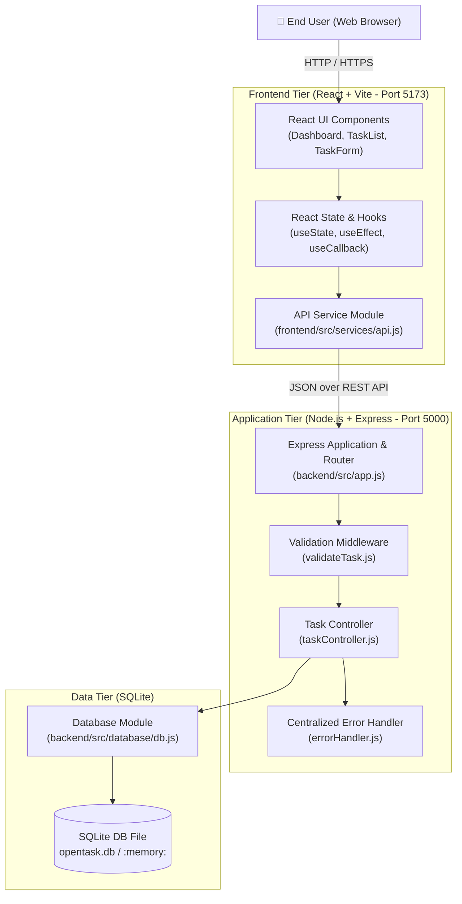
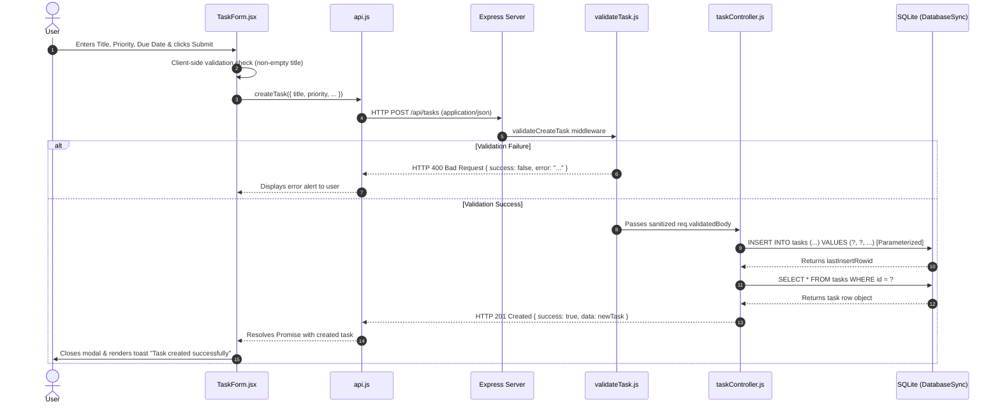
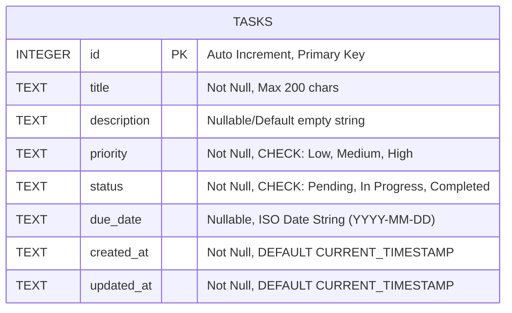

# OpenTask — System Architecture & Design

## 1. Architectural Overview
OpenTask follows a modern, decoupled **3-tier client-server architecture**:
1. **Presentation Tier (Frontend)**: Single Page Application (SPA) built with React 18, bundled by Vite, delivering a component-driven responsive user interface.
2. **Application Tier (Backend)**: Lightweight, modular RESTful API built on Node.js 24 and Express, structured using controller and routing layers with centralized error handling.
3. **Data Tier (Database)**: Relational SQLite database using Node.js built-in `node:sqlite` (`DatabaseSync`), enforcing ACID properties, constraints, and indexes.

---

## 2. Architecture Diagram

---

## 3. End-to-End Request Lifecycle

When a user performs an action (e.g. creating a task):

---

## 4. Database Schema Design (Entity-Relationship)

### Table Definitions & Constraints
- **Primary Key**: `id INTEGER PRIMARY KEY AUTOINCREMENT` guarantees unique sequential IDs.
- **Constraints**:
  - `CHECK(priority IN ('Low', 'Medium', 'High'))`: Restricts priority domain at the database engine level.
  - `CHECK(status IN ('Pending', 'In Progress', 'Completed'))`: Restricts status domain.
  - `title TEXT NOT NULL`: Enforces presence of title on every record.
- **Performance Indexes**:
  - `idx_tasks_status` on `status` column for fast category querying.
  - `idx_tasks_priority` on `priority` column for fast priority filtering.
  - `idx_tasks_created_at` on `created_at` column for sorting.

---

## 5. Security & Design Patterns
1. **Parameterized Queries**: Every SQL statement utilizes `?` parameter markers via `db.prepare().run(...params)`. This completely prevents SQL injection attacks.
2. **Separation of Concerns**: Business logic is separated into controllers, route definitions into routers, validation into middleware, and data access into a dedicated database module.
3. **Environment Agnostic**: The application dynamically handles local SQLite files (`backend/data/opentask.db`) as well as in-memory databases (`:memory:`) during automated testing.
4. **Resilient Error Boundaries**: Unhandled exceptions are caught by `errorHandler.js`, preventing process termination and concealing internal stack traces from clients.
